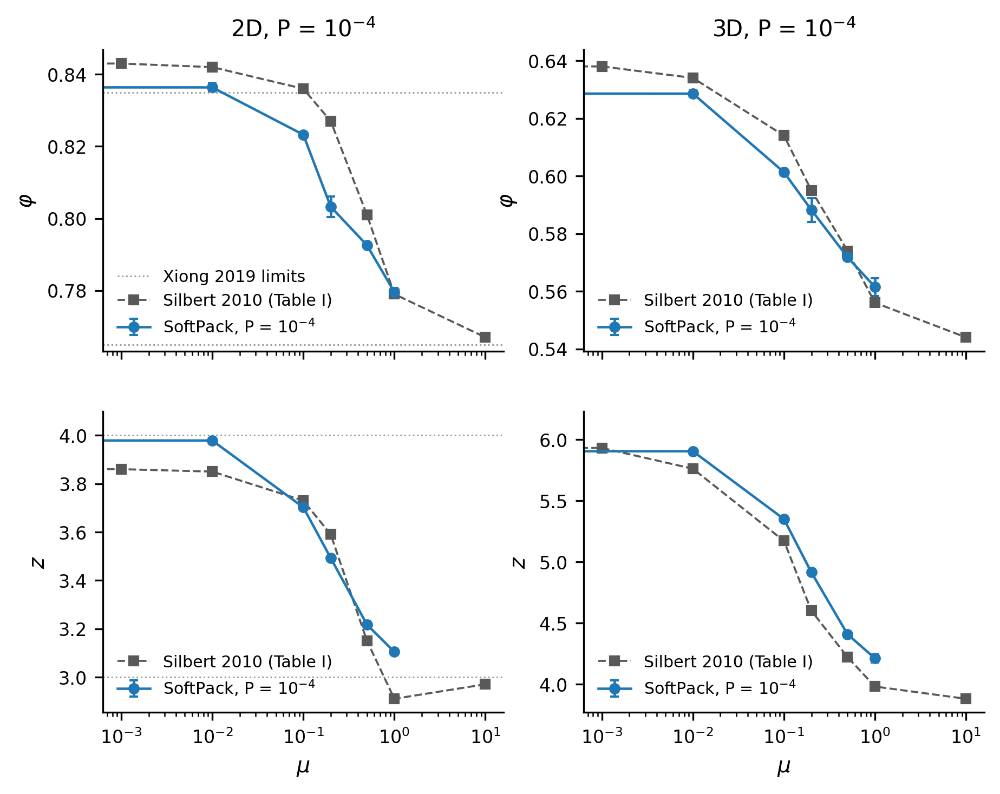

# Friction (Silbert 2010)

*Up:* [Benchmarks](index.md)

[Silbert2010] compressed soft spheres towards jamming for a range of friction coefficients
and extrapolated the jamming packing fraction $\varphi_c^{\mu}$ and coordination
$z_c^{\mu}$ at $P \to 0$. The packing fraction falls from random close packing,
$\varphi_{\text{rcp}} \approx 0.64$, to random loose packing,
$\varphi_{\text{rlp}} \approx 0.55$, as friction grows; the coordination falls from about
6 to 4. The 2D bidisperse row of the same table runs from $0.843$ to $0.767$, with $z$
from $3.96$ to $2.97$.

## Figure

*Packing fraction (top) and coordination (bottom) against $\mu$, for 2D bidisperse disks
(left) and 3D monodisperse spheres (right). Filled circles are SoftPack at
$P = 10^{-4}$; open squares are the extrapolated values of [Silbert2010]; the dotted lines
in the 2D panel are the compression-protocol limits of [Xiong2019].*

## Numbers

| $D$ | $\mu$ | $\varphi$ SoftPack | $\varphi$ Silbert | $z$ SoftPack | $z$ Silbert |
|:---|:---|:---|:---|:---|:---|
| 2 | 0 | 0.8413 | 0.843 | 4.042 | 3.96 |
| 2 | 0.01 | 0.8364 | 0.842 | 3.979 | 3.85 |
| 2 | 0.1 | 0.8233 | 0.836 | 3.702 | 3.73 |
| 2 | 0.2 | 0.8032 | 0.827 | 3.492 | 3.59 |
| 2 | 0.5 | 0.7926 | 0.801 | 3.217 | 3.15 |
| 2 | 1 | 0.7796 | 0.779 | 3.104 | 2.91 |
| 3 | 0 | 0.6369 | 0.639 | 6.111 | 5.96 |
| 3 | 0.1 | 0.6013 | 0.614 | 5.349 | 5.17 |
| 3 | 0.2 | 0.5882 | 0.595 | 4.913 | 4.60 |
| 3 | 0.5 | 0.5718 | 0.574 | 4.407 | 4.22 |
| 3 | 1 | 0.5615 | 0.556 | 4.210 | 3.98 |

## What agrees and what does not

The 3D monodisperse row, which is the closest match to Silbert's system, agrees within
$0.013$ in packing fraction and $0.31$ in coordination over the full range. The endpoints
of the 2D row also agree: frictionless SoftPack gives $0.8413$ against $0.843$, and
$\mu = 1$ gives $0.7796$ against $0.779$.

In 2D at $\mu = 0.1$ to $0.5$ SoftPack sits up to $0.024$ below Silbert's extrapolated
values. This is a protocol difference, not a failed check. Silbert approaches jamming by
decreasing the packing fraction from a dense state; SoftPack compresses from a dilute
start. [Xiong2019], who use isotropic compression, report $\varphi_J$ from about $0.835$ to
$0.765$ and $z_J$ from 4 to 3, with a crossover near $\mu_c = 0.1$; the SoftPack 2D curve
lies inside those limits and follows the compression protocol. The 2D coordination at
$\mu = 1$ is $3.10$ against Silbert's $2.91$, and the frictionless anchors show the same
small positive offset ($+0.08$ in 2D, $+0.15$ in 3D), so the offset is finite-size, not a
friction-model error.

## Reproduce

The run script, the raw CSV and the analysis script are in
[`benchmarks/paper_figures`](https://github.com/ColtonKawamura/SoftPack/tree/main/benchmarks/paper_figures).

## References

- **[Silbert2010]** Leonardo E. Silbert (2010). *Jamming of frictional spheres and random loose packing*. Soft Matter **6**, 2918–2924. [doi:10.1039/c001973a](https://doi.org/10.1039/c001973a).
- **[Xiong2019]** Fansheng Xiong, Philip Wang, Abram H. Clark, Thibault Bertrand, Nicholas T. Ouellette, Mark D. Shattuck, Corey S. O’Hern (2019). *Comparison of shear and compression jammed packings of frictional disks*. Granular Matter **21**, 109. [doi:10.1007/s10035-019-0964-9](https://doi.org/10.1007/s10035-019-0964-9).
