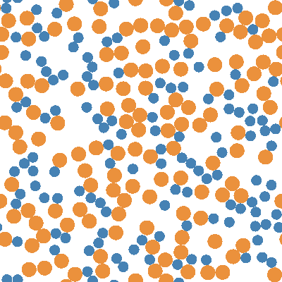

# Benchmarks

SoftPack is checked against the packing literature, not only against its own tests. This
section collects the comparisons, the figures and the numbers behind them.

The checks answer three questions a reader should ask before trusting a packing:

- Does SoftPack reach the same jamming packing fraction and coordination number as the
  standard frictionless packings? The reference is [OHern2003].
- Does it show the same pressure and contact-number scaling as the jamming point is
  approached? The pressure should vanish as $\Delta\varphi$ for Hookean contacts and as
  $\Delta\varphi^{3/2}$ for Hertzian ones; the excess coordination should grow as
  $\Delta\varphi^{1/2}$.
- Does friction move the packing to the same loose states? The reference is [Silbert2010],
  with the compression-protocol values of [Xiong2019] for the 2D comparison.

## The default packing

*The default `pack()` run: 256 frictionless Hookean disks, 50:50 bidisperse with diameter
ratio 1.4, compressed from $\varphi = 0.25$ to $P = 10^{-4}$. The frame is the periodic
box; blue and orange mark the two diameters. The packing takes under a second; rendering
and encoding this movie adds a few seconds.*

The run ends at $\varphi = 0.8387$ and $z = 4.016$ after 12 rattlers are removed, against
the literature values $\varphi_J \approx 0.84$ and $z_J = 4$ [OHern2003].

## What is compared

| Check | System | SoftPack | Reference | Result |
|:---|:---|:---|:---|:---|
| Jamming fraction | 2D bidisperse, Hookean | 0.8408 | 0.842 [OHern2003] | finite-size offset, 0.001 |
| Jamming fraction | 3D bidisperse, Hookean | 0.6434 | 0.648 [OHern2003] | finite-size offset, 0.005 |
| Pressure exponent | 2D Hookean | 1.04 | 1.01 [OHern2003] | within 3 per cent |
| Pressure exponent | 2D Hertzian | 1.52 | 1.50 [OHern2003] | within 2 per cent |
| Pressure exponent | 3D Hookean | 0.97 | 1.03 [OHern2003] | within 6 per cent |
| Pressure exponent | 3D Hertzian | 1.32 | 1.51 [OHern2003] | noisy, see below |
| Coordination exponent | 2D, Hookean / Hertzian | 0.51 / 0.56 | 0.49 / 0.48 [OHern2003] | within 0.08 |
| Coordination exponent | 3D, Hookean / Hertzian | 0.49 / 0.45 | 0.47 / 0.49 [OHern2003] | within 0.04 |
| Friction, 3D | $\mu = 0$ to $1$ | $\varphi = 0.637$ to $0.562$ | $0.639$ to $0.556$ [Silbert2010] | within 0.013 |

The full method, the raw rows and the analysis are in
[`benchmarks/paper_figures`](https://github.com/ColtonKawamura/SoftPack/tree/main/benchmarks/paper_figures).
The runs use the default `FIRE()` and `RelativeForce(1e-8)`; the 2D systems use
$N = 1024$ and the 3D systems $N = 512$, with 2 seeds in 2D and up to 8 in 3D.

## Pages

- [Jamming scaling (O'Hern 2003)](jamming-scaling.md): the pressure and coordination
  scaling, with the published exponents.
- [Friction (Silbert 2010)](friction.md): the friction sweep, the random-close to
  random-loose range, and the compression-versus-decompression difference.

## What the checks do not claim

A packing is a protocol-dependent object. The comparisons use the same protocol family as
the papers where the paper defines it; where it does not, the difference is stated on the
page. Finite-size scatter at $N = 512$ is $0.002$ to $0.004$ in $\varphi$, which is why the
3D exponents are quoted with a range rather than as exact numbers. The point of the
section is to show that SoftPack lands on the published values and scaling within those
uncertainties, not that every run reproduces a published seed.

## References

- **[OHern2003]** Corey S. O’Hern, Leonardo E. Silbert, Andrea J. Liu, Sidney R. Nagel (2003). *Jamming at zero temperature and zero applied stress: The epitome of disorder*. Physical Review E **68**, 011306. [doi:10.1103/physreve.68.011306](https://doi.org/10.1103/physreve.68.011306).
- **[Silbert2010]** Leonardo E. Silbert (2010). *Jamming of frictional spheres and random loose packing*. Soft Matter **6**, 2918–2924. [doi:10.1039/c001973a](https://doi.org/10.1039/c001973a).
- **[Xiong2019]** Fansheng Xiong, Philip Wang, Abram H. Clark, Thibault Bertrand, Nicholas T. Ouellette, Mark D. Shattuck, Corey S. O’Hern (2019). *Comparison of shear and compression jammed packings of frictional disks*. Granular Matter **21**, 109. [doi:10.1007/s10035-019-0964-9](https://doi.org/10.1007/s10035-019-0964-9).
