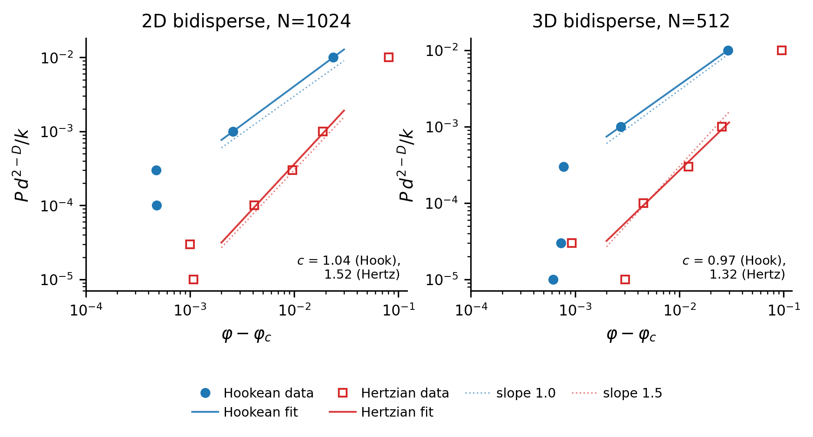
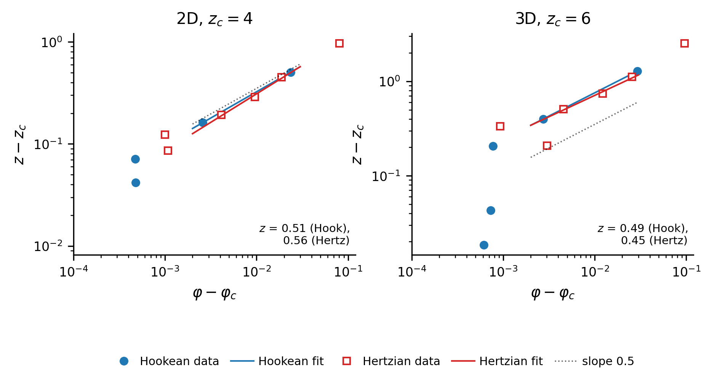

# Jamming scaling at zero temperature

*Up:* [Benchmarks](index.md)

[OHern2003] measured how the pressure and the coordination number approach the jamming
point for frictionless disks and spheres, with both harmonic and Hertzian contacts. The
paper fits

$$\frac{P\,d^{2-D}}{k} = p_0\,(\varphi-\varphi_c)^{c}, \qquad z-z_c = Z_0\,(\varphi-\varphi_c)^{1/2},$$

with $c = 1.01$ for harmonic and $c = 1.50$ for Hertzian contacts, and $Z_c = 4$ in 2D and
$6$ in 3D (their Table I). The packing fraction at jamming is $\varphi_J \approx 0.842$ in
2D and $0.648$ in 3D for the bidisperse mixture [OHern2003].

## Pressure

*Pressure against $\varphi-\varphi_c$ for 2D (left) and 3D (right) bidisperse packings.
Points are SoftPack runs; solid lines are fits on the asymptotic window; dotted lines have
the published slopes 1.0 and 1.5.*

## Coordination

*Excess contact number against $\varphi-\varphi_c$. The dotted line has the published slope
0.5.*

## Numbers

| $D$ | contact | $N$ | $\varphi_c$ (SoftPack) | $\varphi_J$ (paper) | $c$ (SoftPack) | $c$ (paper) | $z$ exponent (SoftPack) | $z$ exponent (paper) |
|:---|:---|:---|:---|:---|:---|:---|:---|:---|
| 2 | Hookean | 1024 | 0.8408 | 0.842 | 1.04 | 1.01 | 0.51 | 0.49 |
| 2 | Hertzian | 1024 | 0.8415 | 0.842 | 1.52 | 1.50 | 0.56 | 0.48 |
| 3 | Hookean | 512 | 0.6434 | 0.648 | 0.97 | 1.03 | 0.49 | 0.47 |
| 3 | Hertzian | 512 | 0.6443 | 0.648 | 1.32 | 1.51 | 0.45 | 0.49 |

The 2D exponents reproduce the paper to a few per cent. The 3D Hertzian pressure exponent
is the noisiest number: the $N = 512$ packing fraction scatters by $0.002$ to $0.004$
between seeds, and the fit window then contains only three points. It is quoted as
$1.3 \pm 0.2$, not as a precise value.

The pressure coefficient $p_0$ is not compared directly: SoftPack uses one stiffness for
every pair, while [OHern2003] scale the pair stiffness by $1/\sigma_{ij}^{\alpha}$. That
changes $p_0$ at fixed $\Delta\varphi$ but not the exponent, and it does not change the
jamming packing fraction.

## Reproduce

The run script, the raw CSV and the analysis script are in
[`benchmarks/paper_figures`](https://github.com/ColtonKawamura/SoftPack/tree/main/benchmarks/paper_figures).

## References

- **[OHern2003]** Corey S. O’Hern, Leonardo E. Silbert, Andrea J. Liu, Sidney R. Nagel (2003). *Jamming at zero temperature and zero applied stress: The epitome of disorder*. Physical Review E **68**, 011306. [doi:10.1103/physreve.68.011306](https://doi.org/10.1103/physreve.68.011306).
